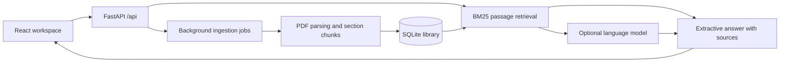

# PaperMind

A local research workspace for reading papers, finding evidence, and keeping sources close to your answers.

PaperMind runs on your own computer. SQLite stores the library and BM25 ranks passages directly from that library. **No Qdrant, Postgres, Vercel, Render, API key, or model download is required to use the default app.** An OpenAI-compatible language model is optional.

## Quick start

Requirements: Python 3.12 or newer, Node.js 22.13 or newer, and npm. Dependency installation needs internet access once.

```sh
make setup
make dev
```

Open [localhost:5173](http://localhost:5173). Choose **Try sample notes** to explore the app with bundled, clearly labeled sample notes, or upload a text-based PDF. Try asking: “How does retrieval help ground an answer?”

The sample library is original demonstration material, not the full text of published research papers. Loading it is repeatable and does not erase your own uploads.

For a single-server app:

```sh
make build
make start
```

Open [localhost:8000](http://localhost:8000). FastAPI serves the built frontend and `/api` from the same origin. The development server is only needed while editing the frontend.

### Docker alternative

With Docker Engine and Compose installed:

```sh
docker compose up --build
```

Open [localhost:8000](http://localhost:8000). A named volume keeps data between restarts. `docker compose down` retains the library; adding `--volumes` deletes it.

## Verification

```sh
make test
```

This runs backend lint/tests, frontend checks, and a production build. Tests use temporary SQLite databases and local fixtures, without provider keys or arXiv calls.

```text
backend/app/api/         HTTP routes and request validation
backend/app/db/          SQLite models and sessions
backend/app/ingestion/   PDF/arXiv ingestion and source-preserving chunks
backend/app/retrieval/   Local lexical passage ranking
backend/app/generation/  Extractive answers and optional LLM generation
backend/app/graph/       Entity and citation relationships
frontend/src/           React workspace
scripts/dev.py          Development process runner
Dockerfile              Single-server production image
```

Run the backend from `backend/` so `.env` and relative storage paths resolve consistently. API documentation is at [localhost:8000/docs](http://localhost:8000/docs).

If ports 5173 or 8000 are busy, stop the other process before starting the app. Scanned PDFs need OCR before importing; this app extracts existing PDF text. No old hosted credentials are needed to troubleshoot a local install.

## Engineering overview

PaperMind implements an evidence-oriented retrieval pipeline with an optional generative layer. It demonstrates document processing, retrieval, LLM integration, evaluation, API design, background execution, and a usable frontend.

| Layer | Implementation |
|---|---|
| Interface | React, TypeScript, Vite, Tailwind CSS |
| API | Python, FastAPI, Pydantic |
| Persistence | SQLite, SQLModel / SQLAlchemy |
| Document processing | PyMuPDF, section-aware chunking with page provenance |
| Retrieval | Deterministic BM25 over persisted chunks |
| Generation | Extractive baseline; optional OpenAI-compatible chat endpoint |
| Quality | pytest, Ruff, ESLint, TypeScript checks, GitHub Actions |
| Packaging | Multi-stage Docker image, Docker Compose, persistent volume |

### Architecture



### Design decisions

- **A working baseline before generation.** Retrieval and source quotes work without an LLM. Provider outages do not prevent reading retrieved evidence.
- **One source of truth.** Search reads persisted chunks, so there is no remote vector index to synchronize or recover.
- **Inspectable provenance.** Chunks retain paper, section, and page references; answers expose the source passages.
- **Explicit tradeoffs.** BM25 is transparent and account-free, but cannot reliably match paraphrases or synonyms. This version does not claim embedding-based semantic retrieval or neural reranking.
- **Bounded workloads.** Upload, page, library, and request limits support a small single-workspace deployment. Search computes corpus statistics per request; this is not a large-scale retrieval service.

## What you can do

- **Build a library:** upload PDFs or search and import from arXiv. Imports report background progress. arXiv access needs an internet connection, but no account.
- **Ask with evidence:** search across the library or scope a question to one paper. Without an LLM, answers quote retrieved passages with section and page references.
- **Research a question:** gather evidence into research notes and a literature matrix. Synthesis and structured extraction improve when you configure an LLM.
- **Explore connections:** view extracted entities and paper relationships. Local extraction is heuristic.
- **Inspect citations:** optional LLM-assisted citation and contradiction checks support manual review; they are not a scientific correctness guarantee.
- **Evaluate retrieval:** run the bundled evaluation on your library. Missing reference papers affect the result. The dashboard shows actual runs, not preloaded benchmark claims.

BM25 is lexical search: it matches words rather than semantic meaning. The evidence score is an uncalibrated heuristic, not the probability an answer is correct. Always read the linked source passages.

See the [sample workspace walkthrough](docs/demo.md) and [architecture](docs/architecture.md).

## Optional language model

Copy `backend/.env.example` to `backend/.env`, set the following values, and restart the backend:

```dotenv
LLM_API_KEY=your-provider-key
LLM_MODEL=your-model-name
# Only set this when using an OpenAI-compatible provider other than OpenAI:
# LLM_BASE_URL=https://your-provider.example/v1
```

`OPENAI_API_KEY` is accepted as an alias. A compatible local server can also be used; set its base URL and the key it expects. Provider requests may send questions and retrieved paper passages to that provider. Keys stay in backend configuration and are never needed in frontend variables. For Docker, export these variables in your shell before starting Compose.

Provider failures during chat fall back to source quotes. Generated chat answers
also fall back to quotes when any generated sentence lacks a citation or
when citation support cannot be established for every cited source pair. The
citation checker is model-assisted, so a
passing check still needs human review. Features that require generation explain
when a model is unavailable. The default offline demo does not call a language
model.

## Data and access

Native development and single-server mode store the database and files under `backend/storage/`. Docker stores them under `/data` in the named volume. Back up the entire storage directory or volume while the app is stopped. The database is the source of truth; no separate search index needs rebuilding.

This is a **single-workspace app without user accounts or per-user permissions**. Commands and Compose bind to loopback by default. Before exposing it to other people over a network, put it behind authentication and HTTPS. CORS and request limits are not authentication. Everyone with API access shares the same library and can trigger operations.

Old hosted databases and files cannot be recovered without an export. This version starts a fresh local library; it does not connect to deleted cloud services. Reimport your PDFs if you still have them. The former Postgres schema is not a supported in-place migration target.

## Evaluation and validation

The evaluation implementation is in [eval_runner.py](backend/app/eval/eval_runner.py), with queries and relevance labels in [eval_dataset.json](backend/app/eval/eval_dataset.json).

| Metric | What it measures |
|---|---|
| Hit@5 / Hit@10 | Whether the labeled relevant paper occurs within the first k retrieved passages |
| MRR | Reciprocal rank of the first passage from the relevant paper |
| NDCG@10 | Discounted rank with a single relevant-paper label |
| Answer keyword match | Presence of expected terms; a coarse diagnostic, not semantic correctness |
| Citation pass rate | Automated citation support checks when available; not independent ground truth |

Retrieval is scored at passage ranks using paper-level labels. These metrics are not directly comparable to evaluations that deduplicate papers before ranking. Import the reference papers before interpreting scores. The illustrative sample notes are a product demo, not a benchmark corpus.

The local rebuild passed **38 backend tests**, Ruff, frontend lint, TypeScript compilation, and the production build. Browser verification covered sample loading and paper-scoped question answering. Integration coverage includes real PDF ingestion, multipage source provenance, persistence, malformed input, deletion after chat, and provider fallback. Docker packaging is included but was not executed in the development environment.

No latency, accuracy improvement, cost savings, or production-scale claims are reported without a reproducible measurement.

## API overview

Interactive OpenAPI documentation: `http://localhost:8000/docs`.

| Route | Purpose |
|---|---|
| `GET /api/health` | Service and storage health |
| `GET /api/capabilities` | Available retrieval and generation capabilities |
| `POST /api/demo/seed` | Load illustrative offline notes |
| `GET /api/papers` | List the shared library |
| `POST /api/ingest/upload` | Submit a PDF ingestion job |
| `GET /api/ingest/jobs/{job_id}` | Poll job progress |
| `POST /api/chat` | Ask across the library or one paper |
| `POST /api/research` | Gather evidence and a comparison matrix |
| `GET /api/graph` | Read the knowledge graph |
| `POST /api/eval/run` | Start an evaluation job |

## Limitations and future work

- No OCR, multi-user isolation, or built-in public-hosting authentication.
- Local graph extraction uses limited heuristics; generated judgments can be wrong.
- Prompt injection in uploaded papers is not fully mitigated. Treat generated output as untrusted, particularly before using it to take actions.
- The bundled evaluation is small and does not establish general research quality.

## License

Read the [changelog](CHANGELOG.md) for release history.

[MIT License](LICENSE) for the project code. Third-party software, models, and datasets retain their own terms.
